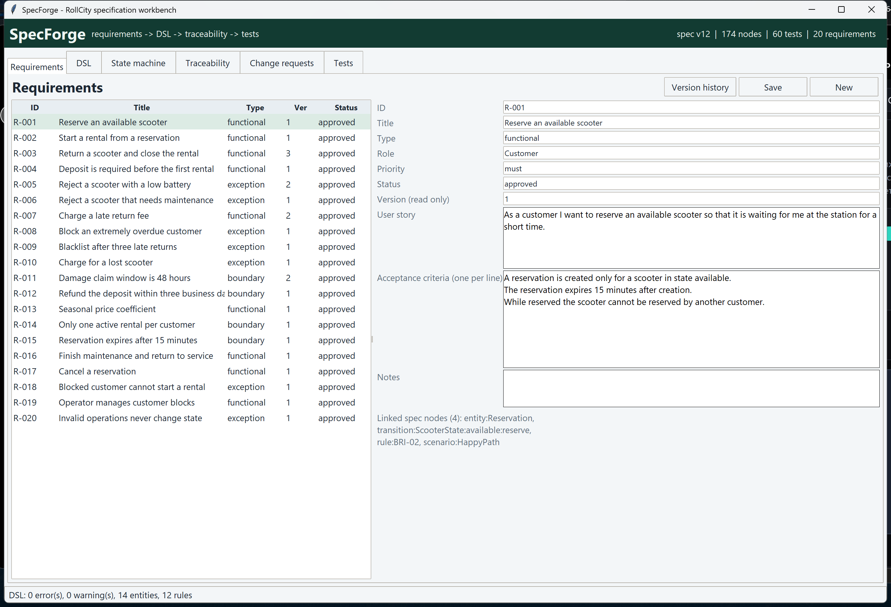
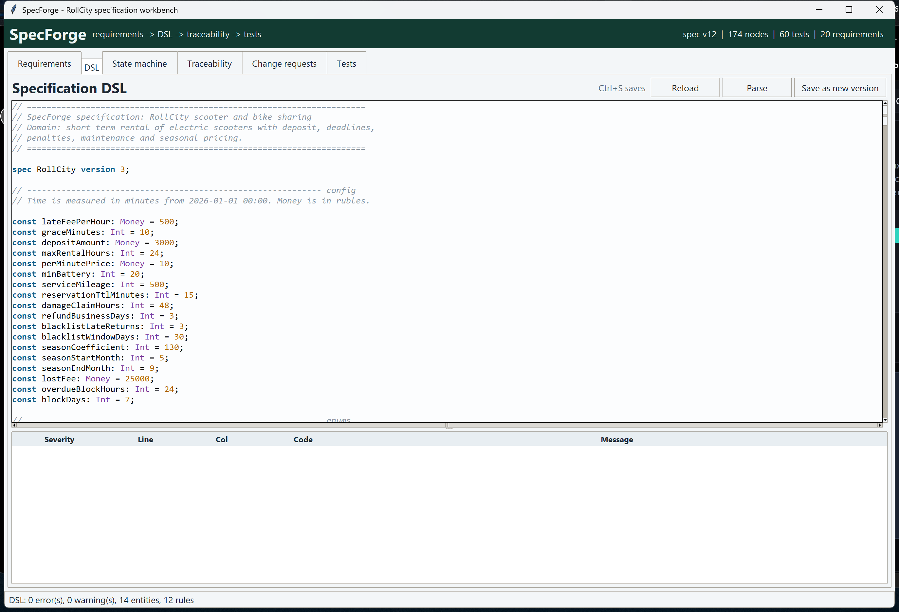
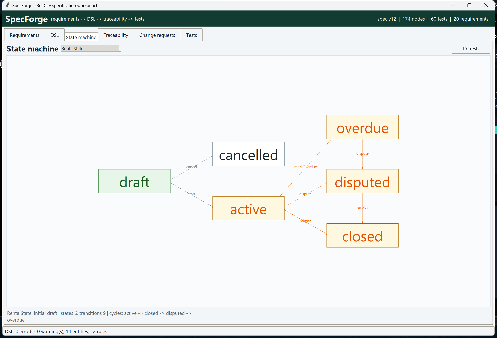
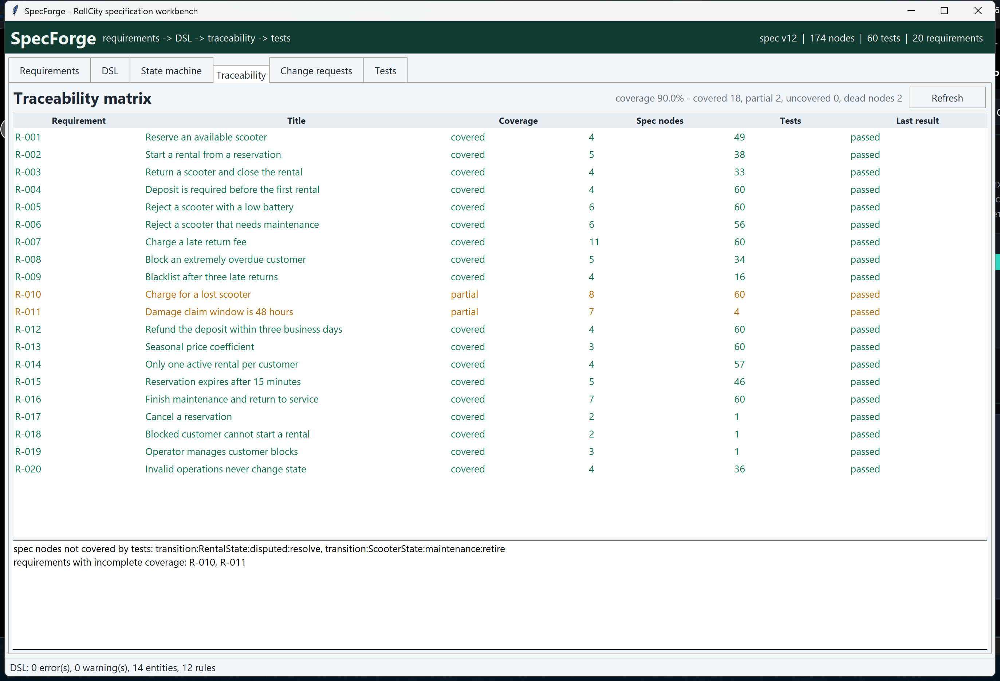
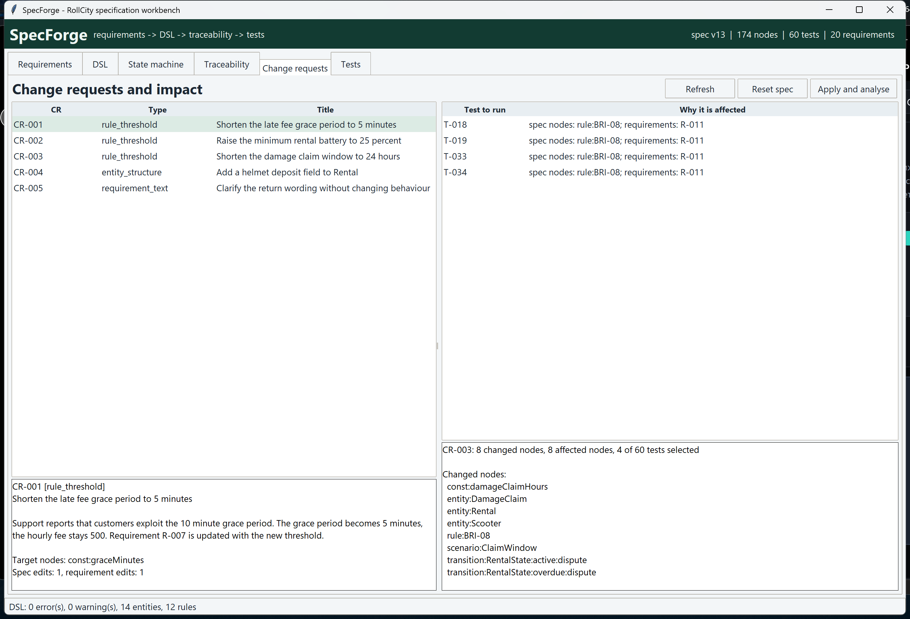
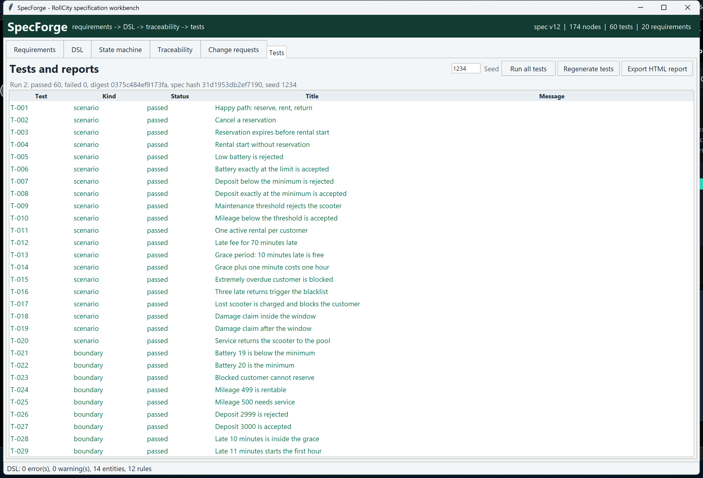

# Демонстрационный набор

## 1. Состав

| Артефакт | Путь |
|----------|------|
| Требования (20) | `specforge/domain/requirements_data.py`, БД, экран Requirements |
| Спецификация DSL | `specs/scooter_share.sforge` (около 600 строк, 174 узла) |
| Тесты (60) | таблица `test_cases`, генератор `runtime/codegen.py` |
| Сценарии DSL (9) | секция `scenario` в спецификации |
| Change Requests (5) | `specforge/domain/change_requests.py`, таблица `change_requests` |
| Базовый прогон | `data/demo/demo.json`, `report.html` |
| Отчеты до/после | `data/demo/CR-001-impact.md` ... `CR-005-impact.md` |
| HTML-отчет | `data/demo/report.html` |

Воспроизведение:

```text
python -m specforge.cli demo
```

Команда создает базу, генерирует тесты, прогоняет базовый набор, применяет
каждый CR на чистой спецификации, проверяет минимальность и пишет отчеты.

## 2. Требования

20 требований: 9 функциональных, 7 исключений, 4 пограничных случая.
Покрытие: 18 из 20 полностью, 2 частично (R-010 и R-011), 0 без
спецификации. Мертвые узлы: `transition:RentalState:disputed:resolve` и
`transition:ScooterState:maintenance:retire`. Они намеренно не покрыты
тестами, чтобы матрица показывала "мертвые" спецификации.

## 3. Тесты

- T-001 - T-020: сценарные, по пользовательским историям и сценариям DSL.
- T-021 - T-040: пограничные: заряд 19/20, пробег 499/500, депозит
  2999/3000, просрочка 10/11/70/130 минут, бронь 15/16 минут, окно ущерба
  48 ч/48 ч 1 мин, сезон 30 апреля/1 мая, дедлайн возврата депозита,
  заряд 0 после возврата, две просрочки без блокировки, блокировка
  клиента оператором.
- T-041 - T-060: property-сгенерированные входы с seed 1..20. Для seed
  берутся заряд, депозит, пробег и время просрочки; ожидаемые значения
  вычисляются на момент генерации и сохраняются литералами.

Базовый прогон: 60 passed, digest
`0375c484ef9173fa0cbaf4d12d696245923418ca9a2d1ebf9bd2eb73838f8c0a`.

## 4. Change Requests

| CR | Тип | Суть | Changed | Affected | Selected | Failed | Минимальность |
|----|-----|------|---------|----------|----------|--------|----------------|
| CR-001 | rule_threshold | grace 10 -> 5 минут | 12 | 12 | 33 | 4 | да |
| CR-002 | rule_threshold | минимальный заряд 20 -> 25 | 7 | 15 | 56 | 6 | да |
| CR-003 | rule_threshold | окно ущерба 48 -> 24 часа | 8 | 8 | 4 | 1 | да |
| CR-004 | entity_structure | поле helmetDeposit в Rental | 6 | 39 | 60 | 0 | да |
| CR-005 | requirement_text | только текст R-003 | 4 | 4 | 7 | 0 | да |

Падения:

- CR-001: T-012, T-013, T-028, T-030. Изменение grace ломает тесты, где
  просрочка 10 минут считается бесплатной, и граничные значения 70/130
  минут.
- CR-002: T-006, T-022, T-042, T-046, T-047, T-055. Самокат с зарядом 20
  перестает быть допустимым; property-сценарии с зарядом 20 меняют исход.
- CR-003: T-033. Заявка ровно через 48 часов теперь вне окна 24 часа.
- CR-004: падений нет, потому что структура не меняет поведение движка;
  structural change выбирает все 60 тестов, так как Rental входит в
  зависимости инвариантов, переходов и большинства сценариев.
- CR-005: падений нет, выбраны тесты, связанные с R-003.

Три CR с разными типами изменений, как требует задание: порог, структура,
текст. Дополнительно два пороговых CR, чтобы показать разные наборы
падений.

## 5. Пример отчета до/после

`data/demo/CR-001-impact.md` содержит:

- версии спецификации до и после (хеши);
- список измененных и затронутых узлов;
- план прогона с причинами выбора каждого теста;
- множество упавших тестов для выбранного и полного прогона;
- флаг минимальности;
- изменения требований.

Пример для CR-003:

```text
Тестов выбрано: 4 из 60
Выбранные: T-018, T-019, T-033, T-034
Упало: T-033
Прогон только выбранных: T-033
Полный прогон: T-033
Минимальность: True
```

## 6. HTML-отчет

`data/demo/report.html` - автономный файл без внешних ресурсов. Разделы:

1. версия требований, версия спецификации, хеш;
2. карточки: требования, узлы, тесты, passed, failed, покрытие;
3. матрица трассируемости с последним результатом;
4. результаты 60 тестов;
5. две машины состояний в SVG с подсветкой циклов и недостижимых
   состояний;
6. диагностика спецификации;
7. история impact analysis с проверкой минимальности.

Экспорт из UI: кнопка "Export HTML report" на экране Tests. Из CLI:
`python -m specforge.cli report --run-tests`.

## 7. Команды демонстрации

```text
python -m specforge.cli stats
python -m specforge.cli scenarios
python -m specforge.cli test
python -m specforge.cli trace
python -m specforge.cli properties
python -m specforge.cli crs
python -m specforge.cli impact CR-003 --reset
python -m specforge.cli incremental --requirement R-013
python -m specforge.cli report --run-tests --out data/report.html
python -m specforge.cli demo
python run.py
```

## 8. Экраны приложения

Скриншоты сняты на демонстрационной базе после прогона 60 тестов.












