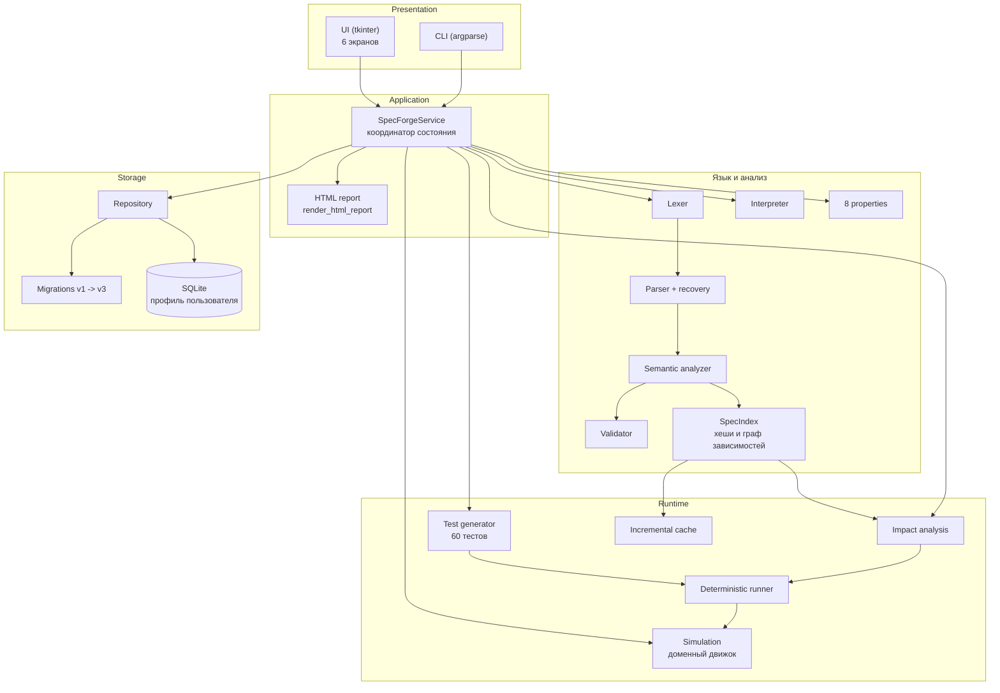
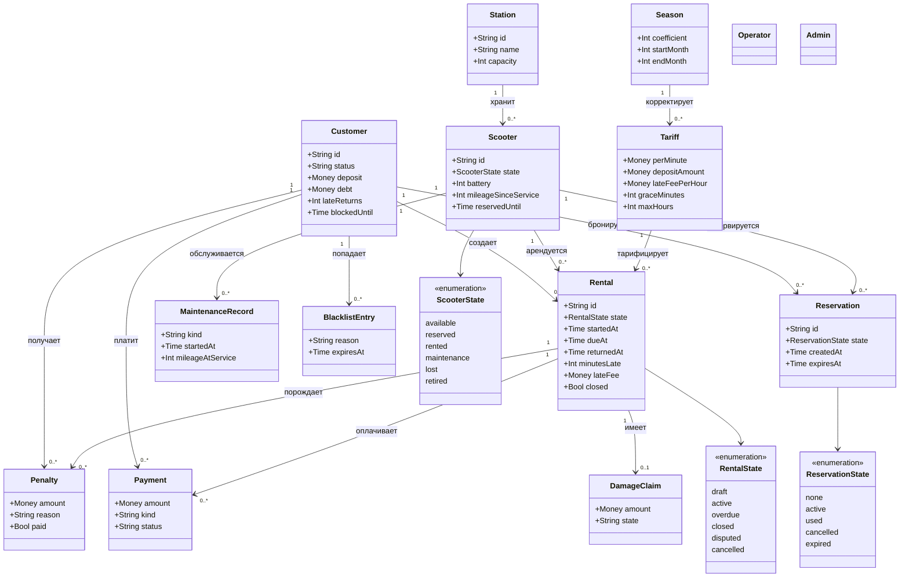

# UML: компоненты и модель домена

Ниже две обязательные диаграммы. Те же диаграммы лежат в PlantUML формате:
`docs/diagrams/components.puml` и `docs/diagrams/domain.puml`.

## 1. Диаграмма компонентов



Поток данных: исходник DSL проходит лексер, парсер, семантику и
валидатор; `SpecIndex` присваивает узлам хеши и строит зависимости. Движок
и интерпретатор исполняют модель, генератор создает тесты, runner
фиксирует результаты. `SpecForgeService` связывает это с UI, CLI, SQLite и
отчетом.

## 2. Диаграмма модели домена



## 3. Машины состояний

`ScooterState`:

```text
available -> reserved : reserve
reserved -> available : cancel
reserved -> available : expire
reserved -> rented : rent
rented -> available : return
rented -> maintenance : returnFault
rented -> lost : lost
maintenance -> available : service
maintenance -> retired : retire
lost -> maintenance : recover
```

`RentalState`:

```text
draft -> active : start / reopen
draft -> cancelled : cancel
active -> overdue : markOverdue
active -> closed : close
overdue -> closed : close
active -> disputed : dispute
overdue -> disputed : dispute
disputed -> closed : resolve
```

Графы строятся в `core/state_machine.py`: BFS для достижимости, Тарьян для
циклов, слоистая раскладка с barycenter-упорядочиванием. Внешние библиотеки
для layout не используются.
